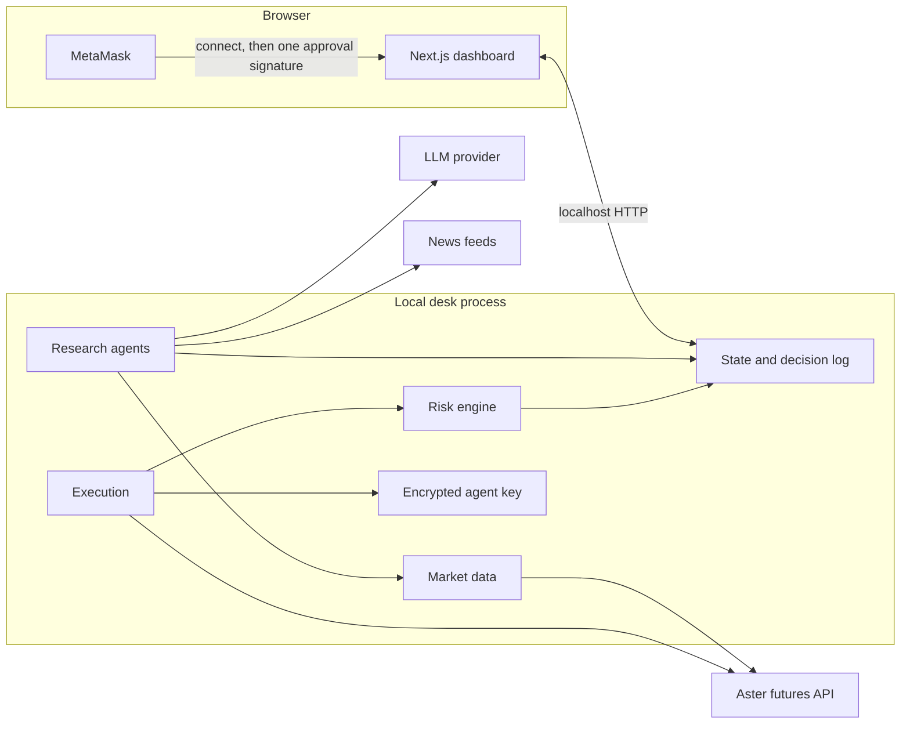

# Autonomous trading desk — design

Stage 0 only. This document is the design for review. No application code has been written.

The venue is Aster perpetual futures. The research behind the API choices is in [ASTER_API_NOTES.md](./ASTER_API_NOTES.md), with source links and the responses captured on 2026-11-14. Where Aster's own pages disagree, this design follows the futures V3 reference in [asterdex/api-docs](https://github.com/asterdex/api-docs) and says so.

## 1. Proposed system architecture

One operator, one machine, two processes, one SQLite file. The desk is not a hosted multi-tenant platform.



### Processes

- **Dashboard.** A Next.js app. It renders state, accepts configuration, connects MetaMask, and sends the one-time agent-approval signature. It does not hold the agent private key and it does not sign orders.
- **Desk worker.** A long-running TypeScript process. It owns market data, the agent loop, the risk engine, paper fills, and the Aster client. It is the only process that can decrypt the agent key, and only after the operator unlocks it, and only while mode is testnet or live.
- **SQLite.** The shared trading state and the append-only decision log. The dashboard reads it through the worker's localhost API. The browser never opens the database and never opens a socket to Aster's private user stream.

Research mode and paper mode do not decrypt the agent key. The execution module is not constructed in those modes.

### Modes

| Mode | Market data | Orders |
| --- | --- | --- |
| Research | Live public data | None. Recommendations are logged. Default. |
| Paper | Live public data | Simulated fills inside the worker. Aster account is not touched. |
| Live | Live public data plus signed account streams | Real orders. Off until the operator turns it on with a separate control from wallet connect. |

A persisted `HALTED` flag overrides all three. The kill switch sets it. Clearing it returns to research, not to live.

### Authority

The spec's workflow is the pipeline. Authority is not a vote.

1. Market, technical, and news agents write observations.
2. The strategy agent writes a ticket: symbol, side, entry type, entry price, stop, targets, rationale, setup name. A ticket with no stop is invalid.
3. The risk engine is deterministic code. It sizes the ticket or rejects it. It can halt the desk. An LLM cannot sit in this step.
4. The head trader may reject a risk-approved ticket, or accept it, or accept a smaller size. A smaller size goes through the risk engine again. The head trader cannot raise size, raise leverage, remove the stop, or clear a halt.
5. The execution agent places the order only when mode allows it and the ticket is still approved. On paper, "places" means the paper engine.

Risk outranks the head trader. That is the veto.

### What runs where

Deterministic code, not the LLM:

- candles, RSI, MACD, EMA, SMA, VWAP, Bollinger Bands, swings, breakout levels
- regime labels that are simple rules on those series (for example trend versus range from EMA slope and band width)
- position size, leverage cap, liquidation buffer, exposure, daily loss, drawdown, loss streak
- order construction, filters (tick, step, min notional), client order ids, retries
- the kill switch

The LLM writes prose and a structured judgment inside a schema: narrative summary, event risk (low/high), and accept or reject. It does not receive a tool that can call Aster. If the schema fails validation, the ticket is rejected and the raw output is stored.

### Scope of the first product

USDT-margined Aster perpetuals. First symbols BTCUSDT and ETHUSDT. A watchlist can add other `TRADING` perpetuals from `exchangeInfo` later. Spot, Shield mode, stocks, Solana accounts, and SUI are out of the product. Deposits and withdrawals stay in Aster's own interface.

Hedge mode (`positionSide` LONG/SHORT) is the intended account setting, because the spec wants long and short as distinct positions. Switching mode is a one-time operator action. The worker must not flip `POST /fapi/v3/positionSide/dual` on its own: the call changes every symbol, and Aster rejects it while orders or positions are open.

## 2. Technology stack

| Piece | Choice | Why |
| --- | --- | --- |
| Dashboard | Next.js, TypeScript, Tailwind, shadcn/ui | The UI is a real app, and these are the default building blocks. |
| Wallet | wagmi and viem | Connect, disconnect, account, and `signTypedData` for the approval. No custom wallet code. |
| Desk worker | TypeScript on Node, same repo | One signer implementation shared with the types the dashboard uses. The worker is a separate process so a web request cannot place an order by accident. |
| Aster client | A small module we write | There is no official TypeScript V3 SDK. The Python connector is HMAC V1. See the notes. |
| Indicators | A tested library plus unit tests on known series (`technicalindicators` or an equivalent with the same formulas) | The formulas stay in code. |
| State | SQLite via `better-sqlite3`, WAL mode | One operator, one file, no extra database service. The log is durable across restarts. |
| Validation | zod | Agent outputs and risk tickets are parsed, not trusted. |
| Tests | vitest for units, the worker's HTTP API for integration, Playwright later for the dashboard | Each stage below names the tests that have to pass. |
| LLM | One provider behind a single interface | The rest of the desk does not import a vendor SDK except inside that interface. |

Repository layout when Stage 1 starts, still one project rather than a platform:

- `apps/web` dashboard
- `apps/desk` worker
- `packages/aster` types, signer, REST and WebSocket client
- `packages/risk` pure functions
- `docs` this design

### LLM options

The interface takes a schema and returns an object. Temperature stays low. Suggested providers, one of which the operator picks before any stage that calls a model:

- Anthropic API
- OpenAI API
- Google Gemini API

No provider is required for market data, indicators, paper trading, or the risk engine. Those stages run with the LLM port returning "disabled."

### News and sentiment options

Proposed, not yet verified against live feeds:

- RSS from public crypto newsrooms (CoinDesk, Cointelegraph, The Block). No key. This is the default.
- Alternative.me crypto Fear and Greed index. No key. Verify the URL in the news stage before depending on it.
- Optional CryptoPanic API, if the operator wants a tagged news stream.
- Optional Finnhub economic calendar, if the operator wants macro timestamps.

The news agent stores headlines and a high-volatility flag. It does not place orders. Social-network scraping is out of scope.

### Keys the operator provides later

None of these go in the repo.

| When | Secret | Required? |
| --- | --- | --- |
| Before the first LLM call | One of `ANTHROPIC_API_KEY`, `OPENAI_API_KEY`, `GEMINI_API_KEY` | Required only for narrative and head-trader judgment. Research still runs without it. |
| News stage, optional | `CRYPTOPANIC_API_KEY` | Optional |
| News stage, optional | `FINNHUB_API_KEY` | Optional |
| Before testnet approval | A local passphrase that encrypts the agent key | Required. It is not an Aster secret. |
| Never | MetaMask seed or MetaMask private key | The product has no field for it. |
| Never | A pasted Aster agent private key | Rejected. See security. |
| Never | A V1 HMAC api secret | Out of scope. New V1 keys are discontinued. |

Aster does not issue the agent key. The worker generates it.

## 3. Agent communication design

Agents do not talk by prompting each other in a loop. They append records to one log and read a snapshot.

### Snapshot

The worker keeps one in-memory snapshot and writes the same facts to SQLite on each change.

- mode: `research` \| `paper` \| `live` \| `halted`
- symbols: mark, index, last, bid, ask, funding rate, next funding time, candles per timeframe
- account: Aster equity, available margin, wallet balance, unrealized PnL. Empty unless testnet or live is unlocked.
- positions and open orders, from the user stream when live, from the paper book otherwise
- risk limits: the current version id
- session counters: daily realized loss, equity high-water, consecutive losses, halt reason

### Decision log

Append-only table `events`:

| Column | Meaning |
| --- | --- |
| `id` | Unique |
| `ts` | Worker clock, plus Aster server time when the event is about an order |
| `agent` | `market`, `technical`, `news`, `strategy`, `risk`, `head`, `execution`, `operator` |
| `kind` | `observation`, `ticket`, `risk_decision`, `head_decision`, `order`, `fill`, `halt`, `config_change` |
| `correlation_id` | Ties one idea from scan to outcome |
| `parent_ids` | Records this one relied on |
| `payload` | JSON, schema depends on `kind` |
| `valid` | False when an LLM payload failed the schema |

Nothing in this table is updated to hide a rejected idea. Corrections are new rows.

### Ticket schema

A strategy ticket, after zod:

- `symbol`, `side` (`LONG` or `SHORT`), `setup` (one of the named strategies below)
- `entry` (`MARKET` or `LIMIT` plus price)
- `stop` price and `workingType` (`MARK_PRICE` by default)
- `targets` (one or more prices)
- `timeframe` that produced the setup
- `invalidation` in one sentence
- `indicators` the code attached (values, not a story)
- `news_flag` from the news agent (`clear`, `caution`, `stand_down`)

`stand_down` means the strategy agent must not emit a ticket. The news agent does not size risk.

### Risk decision

```text
risk_cash = equity * risk_per_trade * streak_factor
qty = risk_cash / abs(entry - stop)
```

Then cap by max position notional, max portfolio exposure, max leverage, available margin, and the symbol's min quantity, step, and min notional.

- `streak_factor` is 1, then 0.5 after two consecutive losses, then 0 at the configured max streak (the desk halts new entries).
- The factor never goes above 1. A win does not increase it.
- If the capped quantity is below the exchange minimum, the decision is **reject**. The engine does not round the order up.
- Leverage sent to Aster is the configured maximum (default 3), and only if the bracket allows it and the initial margin fits. The engine does not raise leverage to make a rejected order fit.
- Estimated liquidation comes from the position after the fact (`positionRisk.liquidationPrice`). Before sending, the engine checks that the stop is farther from entry than zero and on the correct side, and that a rough liquidation estimate (maintenance margin from the bracket) sits beyond the stop. If the stop would be beyond liquidation, reject.

The risk row stores inputs, qty, leverage, reject reason, and the limit version id. Execution refuses a ticket whose version is not current.

### Loop

On each closed candle for the decision timeframe (default 15m, with 1h and 4h as context):

1. Market agent writes regime, volatility, and spread.
2. Technical agent writes indicator values and setups that the code already detected.
3. News agent writes the flag from the latest headlines. If the LLM is disabled, the flag stays `clear` unless a manual operator stand-down is on. It does not invent a caution.
4. Strategy agent ranks the code-detected setups and emits at most one ticket per symbol per side.
5. Risk, then head, then execution.

Setups the code can detect, which matches the spec's list without asking a model to invent a signal:

- trend following and moving-average cross (EMA/SMA stack)
- momentum (MACD histogram and RSI band, both required)
- breakout and failed breakdown of a prior swing
- mean reversion to VWAP or the Bollinger midline, only when the market agent says range
- RSI divergence against a swing, as a tag on another setup, not as a standalone order
- volume expansion versus the last 20 bars, as a filter on breakouts

The strategy agent picks among setups the code flagged. It does not create a setup the indicators did not flag. Combining indicators means the ticket must list every condition that passed; the risk engine does not care which story it is, only that stop, R:R, and size pass.

Minimum R:R default 1.5, measured from entry to the first target versus entry to the stop. A ticket under that is a risk reject.

### Learning

After a flat close, a `journal` row stores setup, regime, timeframe, predicted direction, realized R, holding time, fees, and funding. A later selector may down-rank a setup whose realized expectancy over a minimum sample is negative. That selector writes a new config row. It cannot write risk limits, mode, or the agent approval. The operator sees the weight change in the log. Weights affect which tagged setup is preferred when two are valid. They do not change size.

### Concurrency

One worker, one order at a time per symbol. A mutex per symbol covers submit, so a double candle close cannot double-send. `newClientOrderId` is `{correlation}-{leg}` and is checked against open orders before a second submit.

## 4. MetaMask integration approach

Three states, shown as three separate rows in the dashboard. Connecting the wallet does not authorize trading and does not authorize a transaction.

### Wallet connection

- Connect uses the injected EIP-1193 provider through wagmi. Disconnect clears the wagmi session.
- The UI shows the checksum address and the chain the wallet is currently on.
- A native balance (ETH, BNB, or whatever the active chain uses) may be shown with the label **wallet balance, not trading capital**.
- Connect does not call `personal_sign`, `eth_sign`, `signTypedData`, or `eth_sendTransaction`. A test will fail if a connect handler requests a signature.

The product never asks for a seed phrase or a private key. There is no input for one, and the worker has no route that accepts one.

### Transaction authorization

A transaction would move assets on Ethereum, BSC, or Arbitrum (a deposit `depositFor`, an approval, a transfer). This product does not send those transactions.

The UI copy tells the operator to fund the Aster futures account on Aster's site. Our withdraw and transfer clients do not exist. If a future version adds a deposit button, it has to be a separate design review: a distinct button, a distinct MetaMask transaction prompt, and no reuse of the trading-authorization signature.

### Trading authorization

This is the Pro API agent, documented as `POST /fapi/v3/registerAndApproveAgent` in the [futures V3 reference](https://github.com/asterdex/api-docs/blob/master/V3(Recommended)/EN/aster-finance-futures-api-v3.md).

1. The worker generates a new secp256k1 key, encrypts it, and shows the operator the **address only**.
2. The dashboard builds the exact `msg` string from the notes: `canPerpTrade=true`, `canSpotTrade=false`, `canWithdraw=false`, an expiry, and an IP whitelist when we have a stable egress address.
3. The dashboard shows that string in plain text and asks MetaMask to sign the EIP-712 payload. Domain name `AsterSignTransaction`, version `1`, chainId **56** for this approval (the futures reference forbids 1666 here).
4. The worker submits the approval. On success it stores the signer address, expiry, and the flags we sent, and marks trading authorization **on**.
5. Orders after that are signed by the agent key inside the worker. MetaMask is not prompted.

Trading authorization is bound to the connected address. If the operator switches accounts, authorization drops to off until that account has its own agent. The old key is wiped from memory. It stays encrypted on disk until the operator deletes it, and it cannot be used for the new address.

Testnet and mainnet are different approvals (different REST hosts, trade domain chainId 714 versus 1666). A testnet approval does not count as a mainnet approval.

Pasting a key generated on [asterdex.com/en/api-wallet](https://www.asterdex.com/en/api-wallet) is not supported. The futures reference does not document a way to read `canWithdraw` back, so a pasted key is an unknown permission.

## 5. Aster API integration approach

Details, conflicts, and captured responses: [ASTER_API_NOTES.md](./ASTER_API_NOTES.md).

### Client

- Mainnet REST `https://fapi.asterdex.com`, market socket `wss://fstream.asterdex.com`. Both answered on 2026-11-14.
- Testnet REST `https://fapi.asterdex-testnet.com`, socket `wss://fstream.asterdex-testnet.com`.
- Ignore `fapi3.asterdex.com` (403 here) and `fapi5.asterdex.com` (TLS timeout), even though they appear in samples.
- Public reads use `/fapi/v3` and need no key. The desk uses V3 for private calls. It does not implement V1 HMAC. Public `/fapi/v1` still answers; that is not a reason to build on HMAC. New V1 keys stopped on 2026-03-25, per the [api-docs README](https://github.com/asterdex/api-docs/blob/master/README.md).

Market data for the agents:

- REST snapshot at startup: `exchangeInfo`, then `klines` for 5m, 15m, 1h, 4h, 1d.
- Socket: `<symbol>@kline_1m` (aggregated locally into the higher timeframes), `<symbol>@markPrice@1s`, `<symbol>@bookTicker`.
- Funding: `premiumIndex` for the predicted rate and next time, `fundingInfo` for the interval, `income` with `FUNDING_FEE` for what the account actually paid.
- Depth REST only when sizing a market order, so we can estimate slippage. Not a permanent full book unless a later stage needs it.

The symbol's `filters` from live `exchangeInfo` override the examples in the docs. On 2026-11-14 BTCUSDT min notional was 5 and max algo orders was 10, while the doc examples say 1 and 100.

### Orders the execution agent will send

Documented on `POST /fapi/v3/order`:

- Open long: hedge mode, `side=BUY`, `positionSide=LONG`, `MARKET` or `LIMIT`.
- Open short: `side=SELL`, `positionSide=SHORT`.
- Close: the opposite side with the same `positionSide`. In one-way mode, `reduceOnly=true` instead. Hedge mode rejects `reduceOnly`.
- Stop: `STOP_MARKET` with `stopPrice` and `workingType=MARK_PRICE`. `closePosition=true` when the stop covers the whole position.
- Take-profit: `TAKE_PROFIT_MARKET` the same way.
- Leverage: `POST /fapi/v3/leverage` before the entry, integer, capped by our max and by `GET /fapi/v3/leverageBrackets`.

`STOP` and `TAKE_PROFIT` (limit triggers) exist if we need a limit exit. The first execution stage uses market triggers so a fast move still exits.

`OTOCO` via `POST /fapi/v3/placeStrategyOrder` can express entry plus stop plus target in one call. The reference says a rejection may be HTTP 200 with `failureCode`. The first execution stage does not use it. It sends the entry, confirms the fill, then sends the stop and the target as their own orders. That is more requests and it is easier to test. A position is not allowed to remain unprotected: if the stop is rejected, the execution agent flattens with a closing market order and logs the failure.

There is no FOK on the live V3 time-in-force list (`GTC`, `IOC`, `GTX`, `HIDDEN`). IOC is available for a marketable limit that should not rest.

### Signing

Trade requests: EIP-712 `AsterSignTransaction` / `Message.msg`, agent key, domain chainId **1666** mainnet and **714** testnet, as in the futures reference sample. The signed string is the exact form body, signature last. Nonce is a microsecond timestamp, unique per signer. Optional `nonceWindow` of a few seconds on order writes, so a stuck request cannot fill later.

`user` will be included because the authentication table lists it. The official order sample omits it. Testnet decides. See open question 1 in the notes.

### Reads for the dashboard

Signed, after authorization:

- `GET /fapi/v3/balance` and `GET /fapi/v3/account` for equity, available, unrealized.
- `GET /fapi/v3/positionRisk` for positions, leverage, liquidation.
- `GET /fapi/v3/openOrders`, `allOrders`, `userTrades`.
- `GET /fapi/v3/income` for realized PnL, funding, and commissions.
- `GET /fapi/v3/commissionRate` for the fee assumption the paper engine uses.
- User stream `POST /fapi/v3/listenKey` and `wss://fstream.asterdex.com/ws/<listenKey>`, with REST as the fallback. Signing a listen key with an empty parameter list is still an open question; Stage 6 can poll REST.

From 2026-09-01, those signed routes return `-5050` until the main wallet has deposited. Public market data does not.

### Allowlist

The Aster client is a function `call(method, path, params)` that throws unless the path is on a list checked in unit tests. The list is the market routes, the order routes named above, leverage, margin type, position mode read, balances, positions, orders, trades, income, commission, leverage brackets, listen key, and countdown-cancel. It is not "anything under `/fapi/v3`."

Absent from the list, on purpose:

- `POST /fapi/v3/aster/user-withdraw` and the Solana withdraw route
- futures/spot transfer
- sub-account create, bind, and transfer
- `POST /fapi/v3/asset/migrateUser`
- Aster Chain batch transfer
- any spot host (`sapi.asterdex.com`)

`countdownCancelAll` is on the list. The worker heartbeats it on symbols where it has resting orders while live, so a dead process cancels leftover entry orders. It does not close positions. The kill switch does that.

### Errors

- 429: respect the weight headers, back off, do not retry in a tight loop.
- 418: stop trading and surface the ban expiry.
- 503 or a timeout: treat the order as unknown, query by `origClientOrderId`, do not send a second entry until that query returns.
- `-2021` order would trigger immediately, `-2022` reduce-only rejected, `-4061` position side does not match the account setting, `-4062` improper `reduceOnly`: log and fail the ticket closed. Do not widen the price to force a fill. `-4067` and `-4068` mean position mode cannot change while orders or a position exist.
- Filter errors (`-4000` range in the reference): the ticket was built against stale filters. Refresh `exchangeInfo` and reject.

### Paper engine

Paper uses the same ticket and the same risk engine. Fills:

- Market buys pay the ask plus a configured slippage (default 5 bps on BTC and ETH), sells hit the bid minus that slippage.
- Limit orders fill only if a subsequent trade or mark crosses the price. They do not fill at the touch just because the book shows size.
- Stops and targets use mark price, matching `workingType=MARK_PRICE`.
- Fees use `commissionRate` when known, otherwise a configured taker and maker until the first successful read.
- Funding is accrued from `premiumIndex.lastFundingRate` at `nextFundingTime` while a paper position is open.
- Quantity is run through the same tick, step, and min-notional checks as a live order. An illegal paper order is rejected, not rounded into a fantasy fill.

Paper PnL is labeled paper everywhere it appears.

## 6. Security architecture

### No withdrawals

The approval we submit sets `canWithdraw=false` and `canSpotTrade=false`. The dashboard shows the operator that string before MetaMask signs. The client allowlist has no withdraw, transfer, migrate, or sub-account path. The UI has no withdraw button and no destination-address field. The worker never requests the EIP-712 `Action` / `Withdraw` signature described in the [deposit and withdrawal demo](https://github.com/asterdex/api-docs/blob/master/demo/aster-deposit-withdrawal.md), which EVM withdraws need on top of the agent signature.

This is defense in depth, not a claim that Aster's flag was proven by reading it back. The futures reference does not document that read. A later testnet check may try a withdraw call and expect a rejection; if the only test is a real transfer, we will not run it.

V1 "TRADE-only" keys are documented on [docs.asterdex.com](https://docs.asterdex.com/for-developers/aster-api/api-documentation) and are the wrong generation for a new desk.

### Agent key storage

- Generated in the worker with a CSPRNG. 32-byte secp256k1 private key.
- Encrypted at rest with a passphrase the operator types into the localhost UI. AES-256-GCM, unique salt and nonce, key derived with scrypt. The passphrase is not written to the log, the database, or an env file.
- On disk: signer address, ciphertext, salt, nonce, expiry, and the flags we requested. The database file is in a local data directory, gitignored.
- Decrypted key lives in worker memory only after unlock, and only if mode is testnet or live. Lock on halt, on disconnect, and on process shutdown. Paper and research never call decrypt.
- Logs print the signer address and Aster order ids. They do not print the key, the passphrase, the signature payload's key, or LLM credentials.
- Deleting trading authorization destroys the ciphertext. Aster-side revoke depends on expiry and on whatever delete control Aster's website offers. If we later find a documented revoke route, we will call it as part of delete. Until then, expiry is mandatory (proposed 30 days, operator can choose shorter) and the operator can also revoke in the Aster Pro API page.

### Kill switch

A button and a localhost endpoint do all of the following, in order, and they are idempotent:

1. Persist `HALTED` before any cancel, so a crash mid-flight still comes back halted.
2. Stop the strategy loop.
3. Cancel open orders on every symbol we have touched (`DELETE /fapi/v3/allOpenOrders`), then read `openOrders` and cancel anything left.
4. Close positions with market orders (hedge close, or `reduceOnly` in one-way).
5. Read `positionRisk` until flat or until a documented error. Repeat the close once on a partial fill.
6. Leave the desk halted. Resume lands in research. Live requires the live gesture again.

On paper, the same steps flatten the paper book and cancel paper orders. No Aster call.

`countdownCancelAll` is an extra, not the kill switch. It only drops resting orders if the heartbeat dies.

### Live is off by default

The config default is `research`. The live control is a separate screen. It requires:

- trading authorization present for **mainnet**
- the agent unlock passphrase entered this session
- the operator typing a fixed phrase (`ENABLE LIVE`) so a stray click cannot do it
- risk limits at the current version, shown on the same screen

Testnet execution is its own mode flag, not live. The UI says testnet in the header whenever the REST host is the testnet host.

### Risk manager veto

Every ticket passes through the pure risk function. Execution's first lines re-check the decision: same correlation id, same qty, same stop, current limit version, mode not halted, and the decision's timestamp within a short TTL (proposed 30 seconds) so a stale approval cannot fire after the market moves. Failure means no order.

The head trader's model output cannot skip this. There is no admin override flag in the ticket schema.

### No silent risk-limit changes

Limits live in `risk_limit_versions`. The active row is the newest **operator-confirmed** row.

- Tightening (lower leverage, lower size, lower loss cap, higher minimum R:R, shorter streak) applies immediately and is logged.
- Loosening does not apply until the operator confirms it on a screen that shows old and new values. A model, a journal selector, or a config file edit that is not confirmed does not become active.
- The worker loads limits from the database, not from an env var that a process restart could change underneath a running live session. An env var can seed the first version only.

### No martingale

The sizer's streak factor is at most 1 and falls after losses. Tests assert that after a losing fill, the next computed `risk_cash` is less than or equal to the previous one for the same equity and the same stop distance. There is no "recovery multiplier" parameter in the schema. Adding one is a design change, not a config change.

### Other limits

- The dashboard binds to localhost.
- CORS is the dashboard origin only.
- The worker refuses to start live if `NODE_ENV` style "I am a dev server" and a mainnet host are combined without the enable phrase already stored as an operator event. The enable phrase is an event, not a URL query parameter.
- Dependency review before Stage 6: the Aster client must not pull in `aster-mcp` or any package whose default tool list includes transfers.

### Defaults proposed for confirmation

| Limit | Default |
| --- | --- |
| Max leverage | 3 |
| Risk per trade | 0.5% of equity |
| Max position notional | 10% of equity |
| Max portfolio gross exposure | 30% of equity |
| Max daily loss | 2% of equity, then halt new entries |
| Max consecutive losses | 3, then halt new entries |
| Max drawdown from session high-water | 10%, then halt |
| Minimum R:R to first target | 1.5 |
| Stop | Required |
| One working entry per symbol per side | Yes |
| Market slippage abort | 10 bps versus mark on BTC and ETH, otherwise skip the market order |
| Agent approval expiry | 30 days |

The operator can replace these before Stage 1. Looser numbers still have to be typed in as the initial confirmed version. They are not a silent change later.

## 7. Development roadmap

Each stage ends with the tests listed. The next stage does not start by skipping a failed one. Stages 1–4 need no Aster secret and no MetaMask signature. Stage 6 is the first stage that needs the operator at the keyboard with a wallet.

Open questions in the API notes that are marked Stage 6 stay open until that stage. They are answered with a testnet call, not with a guess in production code.

### Stage 1 — Market data and research mode

Build the public client, candle store, indicators, and the decision log. Agents write observations and, when the code flags a setup, a ticket. Risk runs in observe-only and writes what it **would** decide. Nothing is sent to Aster except public GETs and the public market socket. No LLM required. Head-trader output is "disabled" until a provider key exists.

Tests:

- Fixture tests for `exchangeInfo`, klines, premium index, and mark-price frames using the captures in the API notes.
- `python3 scripts/verify_aster_public.py` still exits 0.
- Indicator tests: a known RSI, MACD, EMA, SMA, VWAP, and Bollinger series with expected values.
- A research run cannot construct the order client. A unit test imports the research loop and asserts the Aster write function is absent.
- Decision-log test: two agents append, a restart reads the same rows, a row is never updated in place.

### Stage 2 — Paper trading engine

Fill simulator on live quotes, using the rules in section 5. Tickets that pass observe-only risk become paper orders. Stops and targets work on mark price.

Tests:

- Market buy fills at ask plus slippage, not at mid.
- Limit below the market does not fill until price trades through it.
- Quantity that breaks min notional or step size is rejected.
- A paper position accrues one funding interval when `nextFundingTime` passes.
- The process under test has no code path that opens a socket to `/fapi/v3/order`. A grep-style test can cover that, plus a fake HTTP agent that fails the test on any non-GET.

### Stage 3 — Risk engine

Turn observe-only into a hard gate in front of the paper engine. Add the kill switch for the paper book. Add limit versions.

Tests:

- Missing stop, R:R under 1.5, size over the position cap, leverage over the max, and daily-loss halt each reject with a stable reason code.
- After a loss, the next size at the same equity and stop is not larger.
- Drawdown halt blocks a new ticket.
- Kill switch flattens a paper position, cancels a resting paper order, and a following ticket does not fill.
- A loosened limit in the database without an operator confirm row is ignored.
- A tightened limit applies on the next decision.
- Head-trader fixture that asks for a larger qty is ignored; the executed paper qty equals the risk qty.

### Stage 4 — Dashboard

The professional surface on top of paper and research: connection placeholder, paper equity, positions, unrealized and realized PnL, win rate, average R, volume, funding, fees, leverage, active setup, recent trades, agent feed. Empty, loading, and error states are real. Live controls render disabled, with the reason.

Tests:

- Worker API contract tests for the snapshot.
- Browser pass on desktop and a narrow viewport: load, empty account, a scripted paper fill appearing in the feed, kill switch, error banner when the worker is down.
- No control on this stage submits a signature or a POST to Aster.

### Stage 5 — Wallet connect

wagmi connect and disconnect. Address and native balance. Trading-authorization row reads "not authorized." Transaction row reads "this app does not send transfers or withdrawals."

Tests:

- Connect and disconnect in the browser against a wallet extension or a injected mock provider.
- Disconnect clears the address.
- The connect path's test double fails if `request` is called with a signing method.
- Switching accounts clears any stale "authorized" UI even before Stage 6 stores a real approval.

### Stage 6 — Testnet authorization and reads

Operator creates the agent, signs the approval on testnet, and the worker reads balance, positions, and open orders. No new orders yet, or only a cancel of anything unexpected. This stage resolves open questions 1, 2, 3, 4, and 7 in the API notes. If `registerAndApproveAgent` does not match what testnet accepts, stop and update this design before changing the signer. Do not fall back to a pasted key in the same session.

Tests:

- The approval body that is signed contains `canWithdraw=false` and `canSpotTrade=false`. A snapshot of the typed data is stored in the test log without secrets.
- The signer address is not the MetaMask address.
- Wrong passphrase does not decrypt.
- Research mode does not decrypt even if a ciphertext exists.
- A read of `GET /fapi/v3/balance` on testnet succeeds after deposit, or the UI shows `-5050` with instructions to deposit on the testnet site. The stage is not "green" on a guessed balance.
- Allowlist test: a withdraw path throws before any HTTP call.

The operator needs testnet margin for a meaningful balance read. Where that margin comes from is still unknown. The stage includes finding Aster's documented faucet or deposit path, and writing it down, before anyone treats a zero balance as a bug.

### Stage 7 — Testnet execution

Smallest `exchangeInfo` quantity on one symbol. Market and limit, stop, take-profit, leverage change, user-stream or REST position updates, kill switch on a real testnet position.

Tests, mostly against testnet with a tiny size, plus local fakes for failures:

- Entry then stop and target visible in `openOrders`.
- Kill switch leaves `positionRisk` flat and open orders empty.
- A forced 503 from a fake transport leads to a query, not a second entry.
- Duplicate `newClientOrderId` does not create two positions.
- Leverage above the desk max is not sent. Assert the outbound `POST /leverage` body.
- A strategy module with the LLM told, in a fixture, to double size after a loss still gets the pre-loss size or a reject.

### Stage 8 — Live gating

Mainnet host, still defaulted off. The enable phrase, the mainnet approval, and the limit summary are one screen. The first live order is a separate operator action after enable, not an automatic flip when the agents like a setup. A sensible first live check is a minimum-size order the operator confirms by hand, then the autonomous loop.

Tests:

- Fresh install is research, and the live endpoint returns 403 until the enable event exists.
- Enable with testnet authorization and a mainnet host is rejected.
- Paper mode with a mainnet ciphertext present still does not decrypt it. Assert with a spy on the decrypt function.
- Disable returns to research and halts new orders immediately. It does not by itself flatten; the kill switch is the flatten. The disable button and the kill switch are both on the live screen, labeled differently.

### Explicitly later

Not part of the first build: OTOCO strategy orders, chase orders, multi-user hosting, spot, copy trading, mobile native apps, automatic deposits, social sentiment streams, and any change that lets the journal raise a risk limit.

## What has to be true before Stage 1

Stage 1 does not need a key. It does need these decisions, because they change the code:

1. This design is accepted, or the operator sends specific changes. In particular: local single-operator desk, V3 agent rather than a V1 HMAC key, no pasted agent key, no deposit/withdraw UI.
2. First symbols are BTCUSDT and ETHUSDT, USDT-margined perps, hedge mode as the intended account setting.
3. The risk defaults in section 6 are accepted or replaced with numbers the operator wants as the first confirmed version.
4. LLM provider can wait. Pick one before the stage that turns on narrative and the head trader. Until then those agents stay off and the code path still logs setups.
5. Optional news keys can wait. RSS is the default and will be verified when that agent is turned on, not assumed today.

Before Stage 6, additionally: MetaMask, a passphrase, a testnet Aster account, and testnet margin once we know how Aster issues it. Before Stage 8: a real futures deposit made by the operator on Aster's site, a mainnet approval signed in MetaMask, and a deliberate choice to enable live trading.
