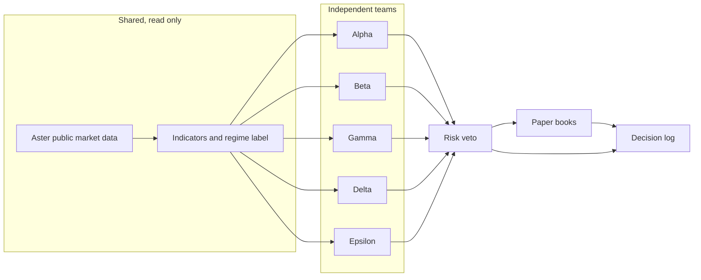

# AI Trading League — design

This evolves the existing Aster paper desk into a five-team competition. It reuses the public Aster client, indicator math, paper fill engine, risk veto, kill switch, decision log, and SQLite books. It does not replace them.

Stage 1 of this design is implemented: five independent paper teams. Stages 2–8 are not. Live Aster orders stay off.

## 1. Spec map

| Spec item | Status | Where it lives |
| --- | --- | --- |
| Five independent teams, own strategy, capital, history | Built in Stage 1 | `apps/desk/src/league/` and one `PaperBook` file per team |
| Teams must not copy each other | Built | Each team has its own proposer. Tests check Alpha does not emit Gamma’s mean-reversion setup. They may still both be long if their different rules agree. They never see each other’s proposals. |
| Chief Portfolio Manager | Not built | Stage 3–4. Stage 1 has no reallocation. |
| Market regime agent | Partial | The existing 15m regime label (`trend_up`, `trend_down`, `range`) is shared context. A dedicated bullish/bearish/sideways/high-volatility agent is Stage 3. |
| Independent risk agent with veto | Built, reused | `packages/risk`. No team can override it. League exposure cap is an extra veto in `runLeagueSymbol`. |
| Central execution | Built for paper | Existing `PaperBook.submitApproved`. There is still no Aster order call. |
| Performance analytics | Not built | Stage 2. Stage 1 shows equity, positions, and the reasoning text only. |
| Identical data, capital, universe, leverage, costs | Built | BTCUSDT and ETHUSDT, 2,000 USDT each, `DEFAULT_LIMITS`, same slippage and fee constants. |
| Record reason, side, entry, stop, targets, size, leverage, expected R:R, confidence, indicators | Built | Decision-log payload on each team ticket and risk decision. |
| Regime drives the PM; suitability is a hypothesis | Not built | Stage 3. Do not hard-code “Alpha only trades in bull regimes” before the results exist. |
| $10,000 pool, $2,000 per team, paper | Built | `LEAGUE_TEAM_CAPITAL`, `LEAGUE_POOL`. |
| Realistic fees, funding, slippage, no fantasy fills | Built, reused | Same paper engine as Stage 2 of the original desk. |
| Execution delay | Not built | Stage 2 of the league. Stage 1 fills on the quote at the 15-minute decision. The delay is not simulated. |
| Leaderboard and composite score | Not built | Stage 2. One outlier trade must not crown a winner; that rule belongs with the minimum sample size, which is also Stage 2. |
| Weekly PM reallocation, reserve, suspension | Not built | Stage 4. Allocation does not change after a win streak in Stage 1. |
| Correlation exposure limits | Closest control now | Each team’s gross exposure cap, plus a league cap of 30% of the 10,000 pool. A pairwise BTC/ETH correlation haircut is Stage 3, when the regime agent exists. |
| Kill switch | Built, reused | Flattens every team book and the old single book, then blocks new fills. |
| MetaMask and Aster V3 live trading | Not built | Stage 6–8, using the already verified agent model in `docs/ASTER_API_NOTES.md`. |
| Research / paper / live modes | Paper and research built | Live is not implemented. Resume still returns to research. Enable paper is explicit. |
| Manual approval before any future live fill | Not built | Required before Stage 8. There is no live switch in this build. |
| Full dashboard sections | Partial | The page lists the five teams, shared market cards, the pool, and the log. Sharpe, Sortino, profit factor, and the PM screen are Stage 2 and Stage 5. |
| Strategy versions and audit trail | Partial | Each proposal stores `strategyId` and `strategyVersion`. Replacing a version in a side book is Stage 2 learning work. History rows are append-only. |
| News, breadth, open interest | Not used for decisions | See the data section. Missing inputs are omitted, not invented. |

## 2. Architecture

One process fetches klines, mark, book, funding, and top-of-book depth once per symbol. It builds one feature snapshot. Each proposer sees only that snapshot. The risk function then sees that team’s own paper account, and the league exposure total. A team never receives another team’s proposal, position, or reasoning.

The old single paper book is still updated for stops and the kill switch so a position opened before the league is not abandoned. New entries go only to the five team books.

## 3. Technology stack

Unchanged from the desk: TypeScript, a Node desk process, Next.js and the existing shadcn card/badge/button components, SQLite through `node:sqlite`, `technicalindicators` for the series that library covers, and the hand-checked session VWAP. No new hosted service, database, or LLM provider. Team rules in Stage 1 are deterministic code.

An LLM can later write the prose around a proposal. It must not be able to change size, leverage, or the risk decision. That wiring is not in Stage 1.

## 4. Agent communication

Shared snapshot, per decision:

- symbol, closed candles, mark, index, bid, ask, funding rate, next funding time
- depth summary when `GET /fapi/v3/depth` succeeds, otherwise null
- indicator features and the simple regime label

Each team returns either nothing or one proposal: side, entry, stop, targets, confidence, reasoning, indicator values, strategy id, strategy version.

The risk agent returns an approve or reject with a stable `code`. The execution step calls `gateExecution` and then that team’s `PaperBook`. Rejected proposals are logged and not filled.

There is no chat bus between teams.

## 5. Data architecture

Stage 1 stores this in the existing SQLite patterns. Later stages add the analytics tables. Names below are the intended schema, including columns Stage 1 already writes.

### teams

| Column | Stage 1 |
| --- | --- |
| id | `alpha`, `beta`, `gamma`, `delta`, `epsilon` |
| strategy_id, strategy_version | On every proposal |
| starting_equity | 2000 in that team’s `paper_account` |
| mode, halted | That book’s `desk_control` |

### strategy_versions

| Column | When |
| --- | --- |
| strategy_id, version, rules_summary, created_ts | Version 1 is the code now shipping. A new version is inserted, never an overwrite. Paper-forward test before it replaces the live version. Not a separate table yet. |

### tickets

Decision-log rows, `kind = ticket`, payload:

`teamId`, `strategyId`, `strategyVersion`, `reasoning`, `confidence`, `indicators`, `side`, `entry`, `stop`, `targets`, `expectedRewardRisk`.

### risk_decisions

`kind = risk_decision`, plus `code`, `action`, `qty`, `leverage`.

### fills, positions, equity

Existing `paper_orders`, `paper_positions`, and `paper_account` in `data/league/<team>.sqlite`. Equity is starting capital plus realized price PnL plus funding minus fees plus unrealized mark PnL. Fills use the bid/ask plus 5 bps for market entries, the mark for stops and targets, and the limit price only after the mark trades through.

### equity_curves

Not built. Stage 2 should append `{team_id, ts, equity, regime}` on a timer. Do not backfill a curve from memory and call it history.

### regime_snapshots

Not built. Stage 3 should store `{ts, label, btc_structure, eth_structure, funding, breadth, inputs_missing[]}`.

### allocations

Not built. Stage 4 should append `{ts, team_id, capital, reason, confirmed_by}` weekly. Stage 1 allocation is the constant 2,000 and does not move.

### audit_log

The append-only `events` table. No update API. Kill, resume, and enable-paper write operator rows.

## 6. What Aster and the current data actually support

Sources: `docs/ASTER_API_NOTES.md`, checked against the futures V3 reference and live public calls on 2026-11-14.

| Wanted by Delta or the regime agent | Verdict |
| --- | --- |
| Order book | Supported. `GET /fapi/v3/depth` and depth streams. Stage 1 uses the top 20 levels, summed as price times quantity. That is not a liquidation map. |
| Funding | Supported. `premiumIndex.lastFundingRate`, `fundingRate`, `fundingInfo`. |
| Public liquidations | Documented stream `<symbol>@forceOrder` and `!forceOrder@arr`. Not wired in Stage 1. It is the legitimate next feed, not a reconstructed stop-hunt model. |
| Open interest | An undocumented `GET /fapi/v3/openInterest` answered once. It is not in the official futures reference. Do not build on it. Closest official inputs are funding plus the public liquidation stream plus the book. |
| Liquidity clusters, sweeps, stop hunts | Not an Aster dataset. Do not invent cluster prices. A later Delta version may mark large resting depth levels from the official book. |
| Volume profile | Not an Aster endpoint. Alpha’s volume rule is the existing 20-bar average, which is computed from klines. |
| ATR, ADX, EMA, RSI, MACD, Bollinger, VWAP | Computed locally from klines. ADX and ATR are in Stage 1 and covered by the indicator library. Stoch RSI and EMA 200 are not in the Stage 1 rules. |
| Breadth | Not an Aster index. Can be computed later from a shared universe of `TRADING` perpetuals in `exchangeInfo`. Stage 1 universe is only BTCUSDT and ETHUSDT, for every team. |
| News | Not an Aster API. No news key is required for Stage 1. The news flag stays clear unless stand-down is on. |
| Correlations | Computed later from our own closes. Not a vendor feed. |

Account equity, positions, and fees on Aster itself still require the V3 signer. Stage 1 does not call those routes.

## 7. Safety rules that still hold

- No withdraw, transfer, migrate, or sub-account code.
- The public client remains GET-only.
- Live mode is not implemented.
- Risk limits do not loosen without an operator confirm row.
- Size does not increase after losses. There is no martingale parameter.
- A head-trader or team confidence number cannot raise quantity or leverage.
- The kill switch persists `halted` before it flattens, and a new entry while halted is rejected.

## 8. Roadmap and tests

### Stage 1 — five paper teams

Implemented in this repo.

Tests that must pass:

- Five distinct strategy ids.
- Alpha does not emit Gamma’s mean-reversion setup on a shared snapshot.
- Each new team book starts at 2,000.
- A stand-down cycle writes no fills.
- Kill switch flattens every team and the next entry is rejected.
- Existing risk, paper, and public-client tests still pass, including no order method on the Aster client.

### Stage 2 — competition engine and analytics

Build the equity curve, win rate, profit factor, max drawdown, average R, duration, fees, and funding from the team books. Sharpe and Sortino need a defined return interval (daily marks). Composite score uses the stated weights only after a minimum closed-trade count and a minimum number of days. One trade cannot clear that minimum.

Tests: a known fill sequence produces the expected profit factor and drawdown; a single winning trade leaves the team ineligible; history rows are not editable.

### Stage 3 — regime agent and portfolio manager

Classify bullish, bearish, sideways, and high-volatility from BTC and ETH structure, realized volatility, and funding. Record missing inputs instead of filling them in. The PM reads the label and the leaderboard. It does not reallocate yet. Team-regime fit is reported, not hardcoded.

Tests: fixture weeks map to the expected label; a missing open-interest field is listed as missing and the label still computes from the remaining inputs.

### Stage 4 — weekly allocation

Once per week, with a minimum sample. Cap any team, keep a cash reserve, stop a team that breaches a risk limit, and never raise capital because of a short streak. Changes are new allocation rows.

Tests: a three-win streak does not change capital; a drawdown breach suspends new entries; an unconfirmed increase is ignored.

### Stage 5 — dashboard

Overview, leaderboard, per-team pages, PM history, risk panel, and the activity feed. Empty, loading, and error states. Desktop and mobile.

Tests: browser pass against a fixture league, including a halted desk and a team with no trades.

### Stage 6 — MetaMask and Aster testnet

The verified V3 agent flow from `docs/DESIGN.md`. Read-only account first. No pasted private key. `canWithdraw` false.

### Stage 7 — security and execution tests

Allowlist still rejects withdraw paths. Kill switch on testnet flattens a tiny position. 503 is treated as unknown. Risk codes still block before any signed request.

### Stage 8 — live

Off until the operator types the enable phrase. The first live fills require a manual approval each time. Autonomous live, inside the same hard limits, is a later switch. Paper results do not by themselves authorize live capital.

## 9. Stage 1 strategies

| Team | Version | Rule that is actually coded |
| --- | --- | --- |
| Alpha | alpha-momentum 1 | Breakout, or momentum only when volume is at least 1.5 times the 20-bar average. |
| Beta | beta-trend 1 | Moving-average cross in the direction of the 15m regime, higher-timeframe agreement, RSI not stretched, and ADX at least 20. |
| Gamma | gamma-contrarian 1 | Mean reversion or a failed break, with an RSI extreme or a divergence tag on mean reversion. |
| Delta | delta-liquidity 1 | Top-20 book imbalance of at least 1.5, funding signed with that imbalance, spread at most 8 bps, stop 1.5 ATR. |
| Epsilon | epsilon-stats 1 | Return z-score beyond 1.5 and an in-sample continuation rate of at least 55% on at least 8 prior shocks in the loaded window. The reasoning says the rate is in-sample. |

All five then face the same risk limits on their own 2,000 USDT book. A position whose raw notional exceeds 10% of that book is rejected rather than silently cut down.
